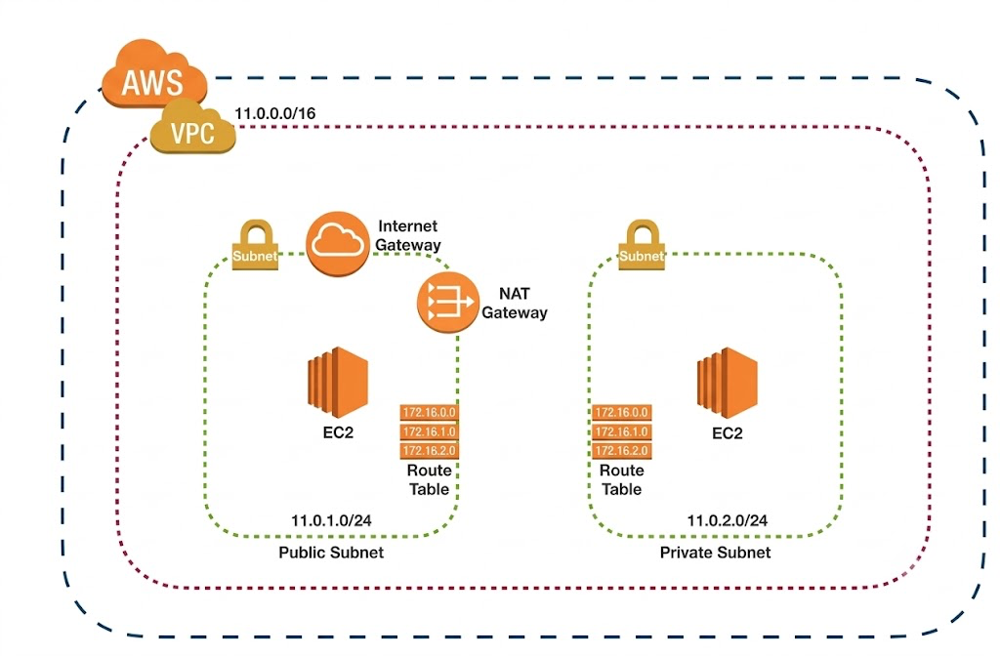

# AWS VPC Public-Private Network

# AWS VPC Networking: Public and Private EC2

## Project Overview
Built an AWS networking environment using the AWS Management Console to learn VPC networking, subnet isolation, internet connectivity, and secure access to private EC2 instances.

## Architecture
- Custom Amazon VPC
- Public subnet and private subnet
- Internet Gateway attached to the VPC
- NAT Gateway deployed in the public subnet
- One public EC2 instance
- One private EC2 instance
- SSH connection from the public EC2 instance to the private EC2 instance

## Network Design

### Public Subnet
The public subnet uses a route to the Internet Gateway. The public EC2 instance is used as a jump host for accessing the private instance.

### Private Subnet
The private EC2 instance does not need a public IP address for SSH access through the public instance. The private subnet can use a route to the NAT Gateway for outbound internet connectivity.

### Security
- SSH access to the private instance is performed through the public EC2 instance.
- Security groups should allow only the required traffic from trusted sources.
- Private SSH keys are excluded from this repository.

## Testing
Document the actual connectivity tests and their results here.

## Screenshots
See the `screenshots/` directory for evidence of the AWS configuration and connectivity tests.

## Technologies
- Amazon VPC
- Amazon EC2
- Internet Gateway
- NAT Gateway
- AWS Management Console
- Linux
- SSH
- Git and GitHub

## Cost Management
AWS resources such as NAT Gateways and running EC2 instances may incur charges. Resources should be reviewed and deleted when no longer needed.
